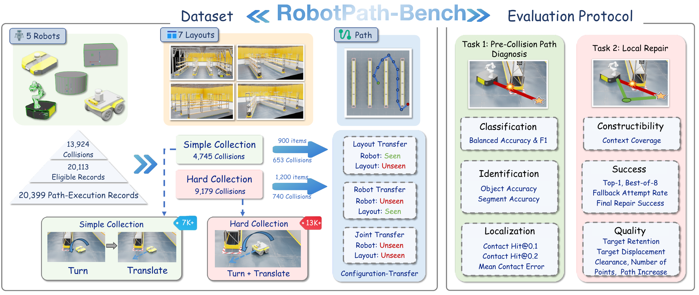

# RobotPath

**RobotPath is an Isaac Sim extension for mobile-robot path planning,
collision checking, replanning, and collision-data collection in warehouse
scenes.** It includes the experiment code used by the associated paper,
baseline planners, layout files, waypoint examples, and a configurable robot
navigation controller.



> This first public release contains the project code and experiment metadata.
> The Warehouse USD and other third-party assets are distributed separately
> while redistribution permissions are being confirmed.

## What is included

- Isaac Sim extension UI for loading layouts, planning, checking, and running
  waypoint navigation.
- `simple` motion: rotate in place, then translate to the next waypoint.
- `hard` motion: rotate and translate during the same simulation step.
- Heuristic, RL, and task-and-motion planning baselines.
- Collision monitoring and collision-data collection interfaces.
- Layout JSON, waypoint files, experiment scenarios, and an asset-free data
  format example.

## Quick start (GUI)

1. Install an Isaac Sim 4.x version compatible with the paper experiments.
2. Obtain a licensed set of compatible Warehouse, shelf, robot, prop,
   material, and texture assets.
3. Point RobotPath to those assets before starting Isaac Sim:

   ```bash
   export ROBOTPATH_ASSET_ROOT=/path/to/licensed/robotpath-assets
   export ROBOTPATH_SCENE_PATH=/path/to/licensed/robotpath-assets/Warehouse.usd
   ```

4. Open the repository as an Isaac Sim extension, enable `RobotPath` from
   **Window > Extensions**, and open the RobotPath window.
5. Select a layout and motion mode (`simple` or `hard`), click **Load Scene**,
   then choose **PLAN**, **CHECK**, and **START** as needed.

If the assets are missing, the extension can still be enabled, but the startup
check will list missing USD files and the Warehouse scene will not load
completely.

## Quick start (headless)

For batch collection, use Isaac Sim's Python interpreter:

```bash
./python.sh headless_collect_dataset.py \
  --layout <layout-name> \
  --motion-mode simple \
  --num-sequences 10
```

Use `--motion-mode hard` to run simultaneous turn-and-translate control and
`--output-dir` to write results outside the repository. The controller API is:

```python
robot_controller.set_motion_mode("hard")
robot_controller.start_waypoint_navigation(waypoints)
```

See [`data/examples/collision_sample.json`](data/examples/collision_sample.json)
for the public collision-data shape.

## Release scope

The first public release is **code-only**. It intentionally does not include
`data/Assets/` or the full `data/collision_dataset/`. The Warehouse scene was
assembled by the project authors, but its USD files may reference NVIDIA,
Fab, or other third-party meshes, robots, materials, and textures. A custom
scene composition does not by itself grant permission to redistribute those
underlying files. See [`docs/ASSET_MANIFEST.md`](docs/ASSET_MANIFEST.md) for
the authorization record.

The extension can still be enabled because its Python module and UI dependency
are present. Loading the Warehouse scene requires the external USD files, so a
missing asset directory produces a clear asset report and the scene will not
load completely. Prepare a compatible, legally obtained asset directory or
wait for a separately authorized asset release.

## Requirements

- Isaac Sim 4.x (use the version used for the associated paper experiments)
- Python shipped with Isaac Sim
- A licensed set of compatible Warehouse, shelf, robot, prop, material, and
  texture assets

## Configure external assets

The default asset directory is `data/Assets` inside the checkout. Since that
directory is excluded from this release, set an external directory before
starting Isaac Sim:

```bash
export ROBOTPATH_ASSET_ROOT=/path/to/licensed/robotpath-assets
# Optional when the scene file has a different name or location:
export ROBOTPATH_SCENE_PATH=/path/to/licensed/robotpath-assets/Warehouse.usd
```

Both the graphical extension and `headless_collect_dataset.py` use these
variables. The startup check reports the missing `Warehouse.usd`, shelf USD,
and robot USD paths. Referenced materials and textures must also be present in
the locations encoded by the USD files.

## Configure the optional Gemini planner

The LLM planner reads its credential from the environment and never stores a
Google API key in the repository. Set one of the following before using the
planner:

```bash
export GOOGLE_API_KEY=your-google-api-key
# GEMINI_API_KEY is also accepted.
```

Do not commit `.env` files or API keys. If a key was previously exposed in a
public commit, revoke it in Google AI Studio/Cloud and create a replacement.

## Repository contents

- `ExtCode/`: extension, planners, controllers, collision checking, and
  baseline implementations.
- `Experiment/`: layout JSON, waypoint examples, and experiment notes.
- `config/extension.toml`: Isaac Sim extension metadata.
- `headless_collect_dataset.py`: headless data-collection entry point.
- `docs/ASSET_MANIFEST.md`: asset provenance and redistribution checklist.
- `docs/RobotPath-1.pdf`: RobotPath-Bench dataset and evaluation protocol.
- `docs/RobotPath-2.pdf`: LLM-RobotPath system overview.

## Asset authorization and later releases

Before publishing an asset package, record the source page, exact version,
license, redistribution and modification permissions, and written permission
where required. Add the corresponding `NOTICE` and third-party license files,
verify USD references and texture/MDL completeness in a clean Isaac Sim
environment, and publish the package under a distinct version tag. The MIT
license in this repository covers project-authored code and documentation
only; it does not license excluded or third-party assets.

## Citation and support

The project papers are available in [`docs/RobotPath-1.pdf`](docs/RobotPath-1.pdf)
and [`docs/RobotPath-2.pdf`](docs/RobotPath-2.pdf). Please cite the associated
paper when using RobotPath in research. Issues and pull requests are welcome
for code and documentation; do not upload assets unless their redistribution
rights are documented.

---

# RobotPath（中文）

**RobotPath 是一个基于 Isaac Sim 的移动机器人路径规划、碰撞检查、重规划
和碰撞数据采集扩展，面向仓储场景中的导航实验。** 仓库包含论文相关的项目
代码、基线规划器、布局文件、路径点示例和可配置的机器人导航控制器。


> 首版公开代码和实验元数据。Warehouse USD 及其中可能涉及的第三方资产，
> 在确认再分发许可前单独提供。

## 已包含内容

- Isaac Sim 图形扩展：加载布局、规划、检查和执行路径点导航。
- `simple` 模式：先原地转向，再移动到下一个路径点。
- `hard` 模式：在同一个仿真步中同时转向和平移。
- 启发式、RL 和任务与运动规划基线。
- 碰撞监控和碰撞数据采集接口。
- 布局 JSON、路径点、实验场景，以及不含资产的数据格式示例。

论文和图示：

- [`docs/RobotPath-1.pdf`](docs/RobotPath-1.pdf)：RobotPath-Bench 数据集与评测协议。
- [`docs/RobotPath-2.pdf`](docs/RobotPath-2.pdf)：LLM-RobotPath 系统概览。

## 图形界面快速开始

1. 安装与论文实验兼容的 Isaac Sim 4.x。
2. 准备合法取得的 Warehouse、货架、机器人、道具、材质和纹理资产。
3. 启动 Isaac Sim 前设置资产路径：

   ```bash
   export ROBOTPATH_ASSET_ROOT=/path/to/licensed/robotpath-assets
   export ROBOTPATH_SCENE_PATH=/path/to/licensed/robotpath-assets/Warehouse.usd
   ```

4. 将仓库作为 Isaac Sim 扩展打开，在 **Window > Extensions** 中启用
   `RobotPath`，然后打开 RobotPath 窗口。
5. 选择布局和运动模式，点击 **Load Scene**，根据需要点击 **PLAN**、
   **CHECK** 和 **START**。

缺少资产时扩展仍可能启用，但启动检查会列出缺失的 USD 文件，Warehouse
场景无法完整加载。

## 配置可选的 Gemini 规划器

LLM 规划器只从环境变量读取凭据，不会在仓库中保存 Google API key。使用
规划器前设置：

```bash
export GOOGLE_API_KEY=your-google-api-key
# 也支持 GEMINI_API_KEY。
```

不要提交 `.env` 文件或 API key。如果密钥曾经出现在公开提交中，请先在
Google AI Studio/Cloud 中撤销旧密钥，再生成新的密钥。

## 无界面快速开始

批量采集使用 Isaac Sim 自带 Python：

```bash
./python.sh headless_collect_dataset.py \
  --layout <layout-name> \
  --motion-mode simple \
  --num-sequences 10
```

使用 `--motion-mode hard` 启用同时转向和平移，使用 `--output-dir` 将结果
写到仓库之外。控制器接口为：

```python
robot_controller.set_motion_mode("hard")
robot_controller.start_waypoint_navigation(waypoints)
```

公开碰撞数据格式见 [`data/examples/collision_sample.json`](data/examples/collision_sample.json)。

## 许可证

仓库中的 MIT 许可证仅覆盖项目自有代码和文档，不覆盖被排除的资产或任何
第三方内容。取得书面授权后，将通过独立资产包或新的版本标签追加资产，并在
`NOTICE` 中记录来源、版本、许可证和完整性验证结果。
